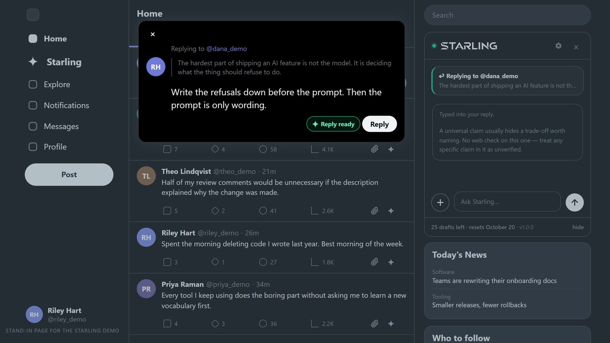
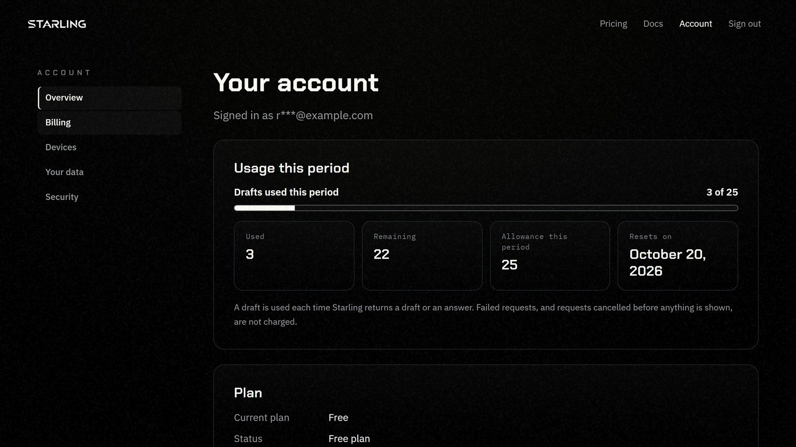

<p align="center">
  
</p>

# Starling

[](https://github.com/realmichaelshad/starling/actions/workflows/ci.yml)
[](LICENSE)

Starling is an AI writing assistant for X. A Chrome extension adds a ✦ button to posts and to X's
composer. Behind it, a hosted service learns how you write and drafts replies, quote posts and new
posts in your voice. The draft is typed into X's own text box and Starling stops there: you edit it,
post it or throw it away. It never presses Post, likes, follows or sends messages.

This repository is the whole product: the extension, the service, the website, the deployment files,
the tests and the documentation. It ran for a few days as a free public beta in autumn 2026 and is
published here under the MIT license.

**See it:** [the product demo on YouTube](https://www.youtube.com/watch?v=QJUr3JpdA3s) and
[a copy of the website](https://starling-demo-ten.vercel.app) with sign-up turned off.



<sub>The extension on a stand-in page with invented accounts. The draft is in the reply box, and
the Reply button is still the writer's to press.</sub>

## What it does

- **Drafts in your voice.** Replies, quote posts, new posts and rewrites, written from samples of
  your own posts and placed in X's composer for you to review.
- **A side panel to talk it through.** Ask for another angle or a shorter version, or ask about how
  your own posts have done.
- **Post ideas from what is new in your niche.** Starling learns your topics from your own posts,
  looks for what is new in them and cites the pages it used.
- **Checks before you see anything.** A draft that fails Starling's own checks is held back, and a
  draft that is held back is not charged.
- **A writing page for phones.** Chrome extensions do not run on phones, so the website has an
  installable page that drafts through the same metered path.
- **Plans and usage.** A free plan and two paid plans in configuration, each with a monthly
  allowance, rate limits and a cost ceiling.
- **Privacy controls.** Drafting starts only after consent in the extension. People can withdraw
  consent, disconnect a browser, export their data or delete their account.



## How it is built

```
 PERSON'S COMPUTER                          OPERATOR'S SERVER (one container, one machine)
 +-----------------------------+            +--------------------------------------------------+
 | Chrome on x.com             |  HTTPS     |  gateway: website, /api/v1, billing, admin       |
 |   Starling extension        |----------->|     |                    |                       |
 |                             |<-----------|     | control database   | spawner socket        |
 +-----------------------------+  streamed  |     v                    v                       |
                                   drafts   |  [SQLite on /data]    supervisor                 |
 +-----------------------------+            |                          | starts one engine     |
 | Any browser: website,       |  HTTPS     |                          | per active customer   |
 | sign-up, account, billing   |----------->|                          v                       |
 +-----------------------------+            |     gateway ---> engine A    engine B    ...     |
                                            |     (local sockets)  |           |               |
                                            |                      v           v               |
                                            |              services: AI proxy + world service  |
                                            +---------|----------------------|-----------------+
                                                      |                      |
                                                      v                      v
                                                 AI provider        news feeds and public
                                                                    pages and images
```

| Part | What it is | Where |
|---|---|---|
| Extension | Chrome, Manifest V3, TypeScript, built with WXT. Permissions: `storage` and `identity`. Hosts: x.com, twitter.com and the one service address compiled into the build. | `extension/` |
| Gateway | One FastAPI application: the website, the extension API, sign-in, checkout and Stripe webhooks, usage metering and the owner's admin pages. | `backend/server/starling_server/` |
| Engine | The drafting pipeline and each customer's own data. One process per active customer. | `backend/engine/` |
| Services | The AI proxy, the only place the AI provider's key is used, and the world service, which keeps a shared news pool and fetches public pages linked in posts. | `backend/server/starling_server/services/` |
| Supervisor | The container's first process. Starts the gateway and services, and starts and stops engines, each under its own operating-system user. | `backend/server/starling_server/supervisor.py` |
| Website | Jinja templates and static assets: the public pages, the help pages, the legal pages, the account and admin pages. | `web/` |
| Storage | SQLite in WAL mode on one volume: a control database, a folder per customer, and encrypted nightly backups. | `backend/server/starling_server/db/` |

The AI provider is OpenAI by default (`gpt-5.6-luna`) or Anthropic (`claude-haiku-5-5`), chosen with
one setting. [docs/ARCHITECTURE.md](docs/ARCHITECTURE.md) has the flows, and
[docs/architecture/CONTRACTS.md](docs/architecture/CONTRACTS.md) is the exact interface between the
parts.

## Worth a look

If you are here to read the code, these are the parts with the most thought in them.

- **Customers are kept apart by the operating system.** Each active customer gets an engine process
  under its own user, with its own data folder, started and stopped by the supervisor
  (`supervisor.py`, `engines/`).
- **One process holds the AI key.** Engines call the AI proxy with a signed token that names the
  customer. The proxy enforces per-call caps and daily and monthly budgets, and records what every
  call cost (`services/`).
- **A draft is reserved, then charged or released.** The gateway reserves one draft before the work
  starts and charges it only when the result is usable. A failure on Starling's side costs the
  customer nothing (`usage/`).
- **Billing that expects Stripe to misbehave.** Webhook signatures are verified, events are queued
  and handled by one serial processor, every handler is safe to run twice, and a reconciler repairs
  what was missed. The tests deliver events duplicated, out of order and late (`billing/`,
  `backend/server/tests/billing/`).
- **Sign-in without a password in the extension.** The extension opens the website through Chrome's
  identity API and exchanges a one-time code, with PKCE, for a device token (`auth/`, `devices/`,
  `extension/shared/auth.ts`).
- **Gates that fail the build.** `scripts/check_site.py` renders every template and checks structure,
  labels, the Content Security Policy and banned wording. `scripts/check_release.py` scans a tree for
  secrets, machine paths and forbidden files. `extension/scripts/verify-extension-build.mjs` checks a
  built extension before it is uploaded.
- **A security review, written down.** What was found and fixed, what was found sound, and what is
  left: [docs/SECURITY-REVIEW-2026-09-20.md](docs/SECURITY-REVIEW-2026-09-20.md).

## Tests

| Suite | Tests | Run it |
|---|---|---|
| Server | 1,611 | `python -m pytest tests` in `backend/server` |
| Engine | 3,354 | `python -m pytest tests` in `backend/engine` |
| Website | 281 | `python -m pytest web/tests` in the repository root |
| Extension | 442 | `pnpm test` in `extension` |
| End to end | API journeys and browser journeys | see [e2e/README.md](e2e/README.md) |

The counts are the tests that pass in continuous integration, on Linux. It runs the three Python
suites on the hash-checked dependency lock, and the extension's type check, unit tests and build, on
every push and pull request.

The end-to-end journeys start the real gateway, services process and engines against stand-ins for
the AI provider, Stripe and Google, and the browser journeys drive the real extension in a real
Chrome. [docs/TESTING.md](docs/TESTING.md) says what each suite proves and what is mocked.

## Run it

You need Python 3.11, Node.js 20.12 or newer, pnpm 10 or newer, and Docker if you want the container.

1. Copy `.env.example` to `.env`. The development defaults need no real credentials: email goes to a
   local outbox and a throwaway session key is generated at start-up. Drafting needs an API key for
   OpenAI or Anthropic. Every setting is explained in [docs/CONFIGURATION.md](docs/CONFIGURATION.md).
2. Start the whole stack in a container, the way production runs it:

   ```sh
   docker compose -f deploy/docker-compose.yml up --build
   ```

   Then open <http://127.0.0.1:8765>.
3. Build the extension against that address and load it in Chrome (Extensions, Developer mode, Load
   unpacked, then pick `extension/.output/chrome-mv3-e2e`):

   ```sh
   cd extension
   pnpm install
   pnpm build --mode e2e
   ```

To work on the code without Docker:

```sh
python -m venv backend/.venv
backend/.venv/bin/python -m pip install -r backend/requirements.in -r backend/requirements-dev.txt
```

On Windows the interpreter is `backend\.venv\Scripts\python.exe`. Then, from `backend/server`, create
the control database with `python -m starling_server.cli migrate` and start the two long-running
processes in this order, with `STARLING_ISOLATION=none`:

```sh
python -m starling_server.services.main
python -m uvicorn starling_server.app:create_app --factory --port 8765
```

In this mode the gateway starts and stops engines itself. To put Starling on a server of your own,
follow [docs/DEPLOYMENT.md](docs/DEPLOYMENT.md).

## Repository layout

| Path | Contents |
|---|---|
| `backend/engine/` | The drafting engine (Python package `app`) and its tests |
| `backend/server/` | The gateway, the services process, the supervisor, the operator command line and their tests |
| `backend/server/config/` | `plans.toml` and `plans-free.toml` (plans and prices) and `ai_pricing.json` (AI prices) |
| `extension/` | The Chrome extension |
| `web/` | Website templates, static assets and their tests |
| `deploy/` | `Dockerfile`, `docker-compose.yml`, `fly.toml` and the deployment runbook |
| `e2e/` | The end-to-end harness, its stand-in providers and the journey tests |
| `scripts/` | The release gate, the website gate and the dependency lock scripts |
| `brand/` | Logo sources, icons and the wordmark |
| `docs/` | Architecture, operations and security documentation |
| `.env.example` | Every setting, with no secrets |

## Documentation

| Document | What it covers |
|---|---|
| [docs/ARCHITECTURE.md](docs/ARCHITECTURE.md) | Components and data flow |
| [docs/architecture/CONTRACTS.md](docs/architecture/CONTRACTS.md) | Exact interfaces between components |
| [docs/SECURITY-AND-PRIVACY.md](docs/SECURITY-AND-PRIVACY.md) | Security model, data inventory and retention |
| [docs/SECURITY-REVIEW-2026-09-20.md](docs/SECURITY-REVIEW-2026-09-20.md) | The security review: what was found and fixed, and what is left |
| [docs/AI-PROVIDER.md](docs/AI-PROVIDER.md) | Model choice, costs, keys and spending safeguards |
| [docs/PLANS-AND-USAGE.md](docs/PLANS-AND-USAGE.md) | Plans, what counts as a draft, limits and margins |
| [docs/PAYMENTS.md](docs/PAYMENTS.md) | Stripe setup, webhooks, taxes and going live |
| [docs/DEPLOYMENT.md](docs/DEPLOYMENT.md) | Zero to a running service: DNS, TLS, secrets, first admin, smoke test |
| [docs/CONFIGURATION.md](docs/CONFIGURATION.md) | Every setting, its default, validation and which process reads it |
| [docs/OPERATIONS.md](docs/OPERATIONS.md) | Monitoring, alerts, backups and restore, incident runbooks, rotation |
| [docs/EXTENSION-PUBLISHING.md](docs/EXTENSION-PUBLISHING.md) | Publishing the extension in the Chrome Web Store |
| [docs/COSTS-AND-ACCOUNTS.md](docs/COSTS-AND-ACCOUNTS.md) | Accounts an operator needs and what running it costs |
| [docs/TESTING.md](docs/TESTING.md) | Every suite and gate, and what is mocked |
| [docs/THIRD-PARTY-LICENSES.md](docs/THIRD-PARTY-LICENSES.md) | License inventory of everything that ships |

## Status and limitations

- **There is no hosted Starling to sign up for.** The beta ran on Fly.io for under a week in autumn
  2026, with the Anthropic provider (Claude Haiku 5.5), web search off and the free plan only. It
  never had outside customers, and that deployment has been taken down. To use Starling you run
  your own instance.
- **Payments have never been taken.** The billing code is tested against the stand-in Stripe in this
  repository. It has not been run against Stripe itself, in a sandbox or live, so do that before you
  charge anyone ([docs/PAYMENTS.md](docs/PAYMENTS.md)).
- **The OpenAI path has not served real traffic.** OpenAI is the default provider and web search is
  an OpenAI feature, but the beta ran on Anthropic. Both are covered by tests against a stand-in
  provider only ([docs/AI-PROVIDER.md](docs/AI-PROVIDER.md)).
- **The services socket needs one setting in production.** Under OS isolation the services process
  cannot bind its default Unix socket, because the supervisor creates `/run/starling` for root only.
  The reference deployment listens on loopback TCP, which is what the beta ran. The proper fix is a
  socket folder the services user owns ([docs/CONFIGURATION.md](docs/CONFIGURATION.md)).
- **One machine.** The gateway keeps per-account state in memory and SQLite has a single writer, so
  Starling runs as one container on one machine. Scaling past that is a redesign, not a setting
  ([docs/OPERATIONS.md](docs/OPERATIONS.md)).
- **The legal pages are drafts.** They carry `[[OPERATOR_...]]` markers until you supply your own
  business details, and production refuses to start while any are left. Have a lawyer read them.
- **X can change its pages.** The extension reads and fills x.com's own interface, so a change on X's
  side can break it until the selectors are updated.
- **Desktop Chrome 120 or later.** No other browser is supported.

## Contributing and security

Issues and pull requests are welcome: see [CONTRIBUTING.md](CONTRIBUTING.md). Please report a
security problem privately, as [SECURITY.md](SECURITY.md) describes, and not in a public issue.

## License

[MIT](LICENSE). Third-party packages and fonts keep their own licenses:
[docs/THIRD-PARTY-LICENSES.md](docs/THIRD-PARTY-LICENSES.md).

Built by [Michael Shadpour](https://michaelshadpour.com). Starling is an independent project and is
not affiliated with or endorsed by X Corp.
